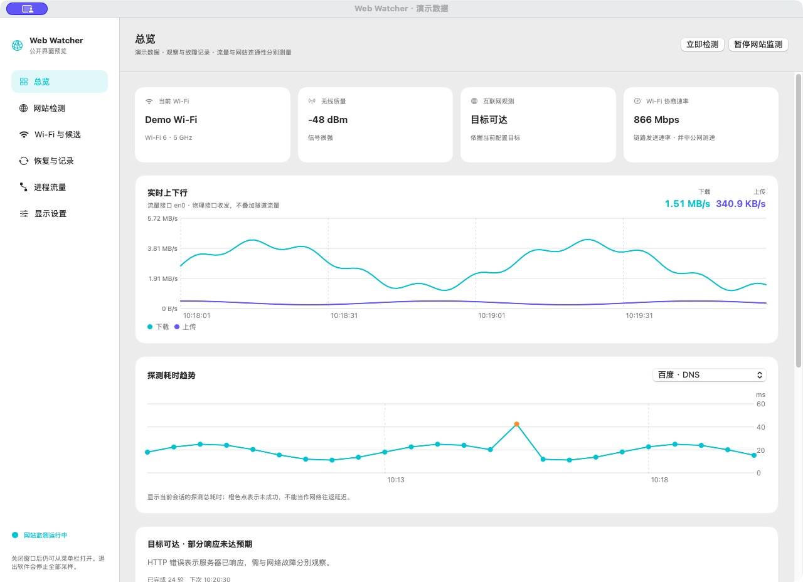
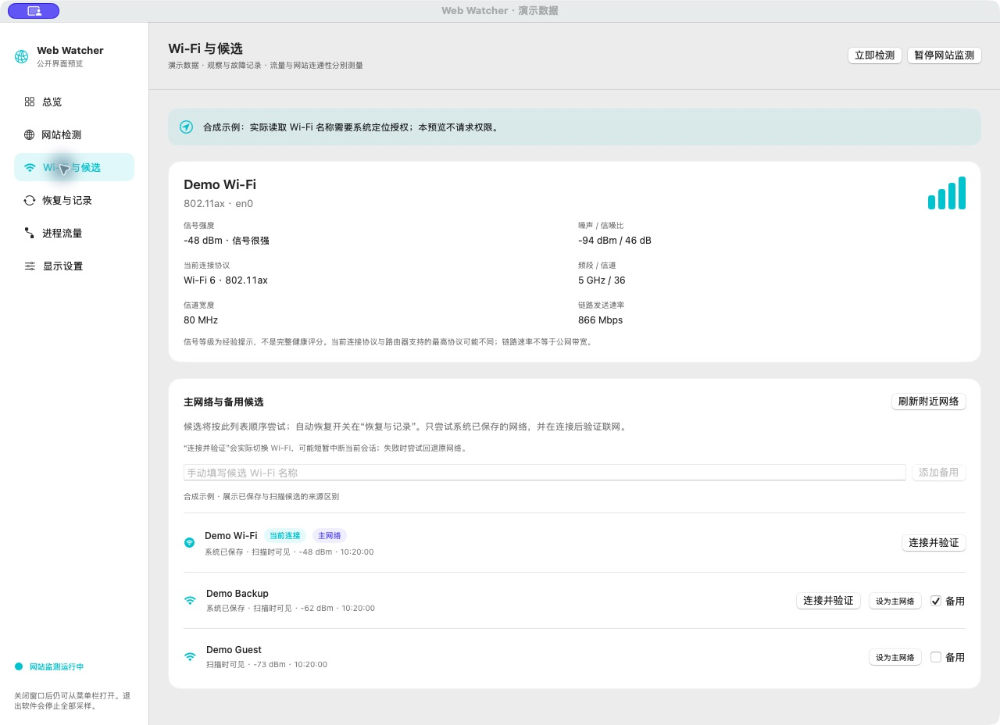
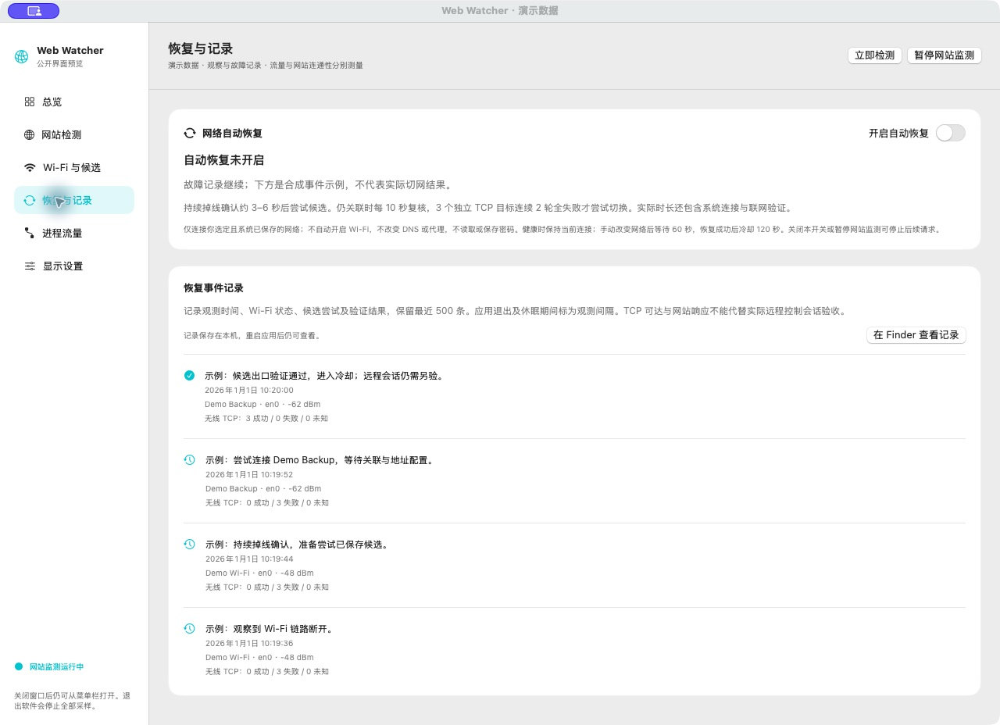
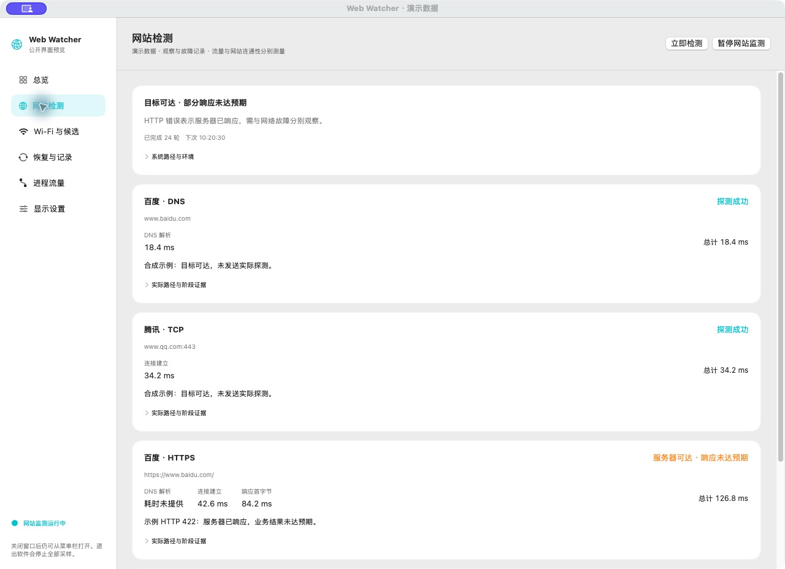
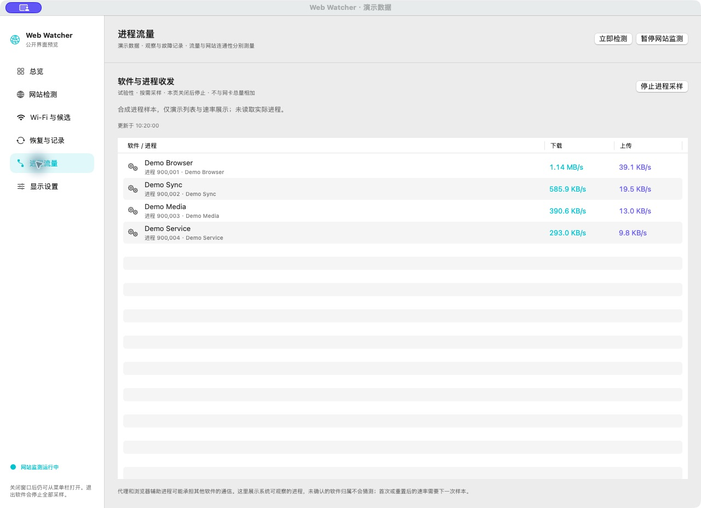
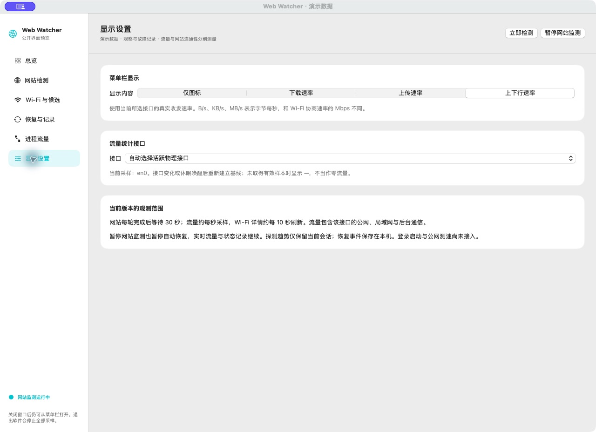
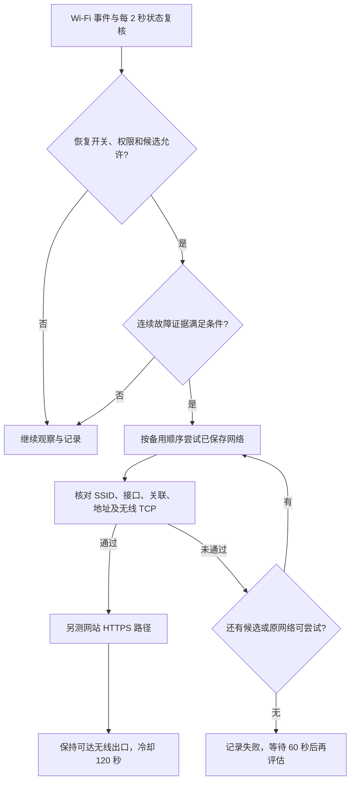

<h1 align="center">Web Watcher</h1>

<p align="center">
  面向 macOS 的本地网络观测与 Wi-Fi 恢复工具。<br />
  看见网络状态，记录断线经过，按证据尝试恢复。
</p>

<p align="center">
  <code>macOS 14+</code>
  <code>Swift 6</code>
  <code>SwiftUI / AppKit</code>
  <code>Swift Charts</code>
  <code>本机存储</code>
  <code>0.3.0 开发版</code>
</p>

<div align="center">
  
</div>

**当前提供可从源码运行的开发版，暂未提供正式安装包。** 自动恢复默认关闭，连接流程与恢复策略已有实现和模拟测试；真实断网、后台凭据、锁屏恢复与长期运行仍待实机验收。

截图使用当前原生 SwiftUI 界面加载**合成示例数据**后截取。Wi-Fi 名称、信号、速率、进程和事件均为演示，不包含私人网络记录，也不是实际切网成功或公网测速的证明。截图说明见 [界面素材说明](docs/screenshots/README.md)。

[快速开始](#快速开始) · [界面与功能](#界面与功能) · [恢复如何判断](#恢复如何判断) · [本地数据与隐私](#本地数据与隐私) · [已知边界](#已知边界)

## 为什么做它

Wi-Fi 图标亮着，往往只能说明无线关联还在。上游不可达、代理异常、DNS 解析失败和网站自身错误，都可能表现为“用不了网络”，需要不同证据才能分清。

Web Watcher 把几类日常问题放进一个菜单栏入口和完整窗口：

- **现在能不能联网？** 分别查看 DNS、TCP、HTTPS 的结果，以及请求经过的可观察路径。
- **无线连接怎么样？** 查看正式 SSID、信号、噪声、当前连接协议和协商速率。
- **谁在使用带宽？** 查看物理接口上下行趋势，按需观察软件与进程收发。
- **刚才发生了什么？** 保留无线状态变化、候选尝试、联网验证与观测间隔。
- **断了以后怎么办？** 在明确启用后，按连续、多目标证据尝试已保存的备用网络，并核验结果。

适合需要持续观察网络的办公、远程主机和日常排障场景。关闭窗口后应用继续驻留菜单栏；明确退出软件才会停止监测。

## 核心能力

| 方向 | 当前能做什么 | 使用条件或边界 |
| --- | --- | --- |
| 网络总览 | Wi-Fi 指标、当前目标状态、实时上下行、探测耗时趋势 | 网卡流量与网站可达性分别解释 |
| 网站检测 | DNS、TCP、HTTPS HEAD；展示阶段耗时、响应状态与实际路径证据 | 当前为内置目标；完整自定义配置尚未接入 |
| Wi-Fi 详情 | SSID、RSSI、噪声、SNR、协议、频段、信道与宽度、发送协商速率 | 名称需系统定位授权；未提供的数据显示未知 |
| 实时网速 | 约每秒读取物理接口收发，绘制上传与下载曲线 | 包含公网、局域网和后台通信，不是主动测速 |
| 主备候选 | 标记主网络、维护备用列表、区分已保存与附近扫描来源 | 扫描可见不等于已经保存凭据或互联网可用 |
| 恢复与记录 | 无线断开与上游疑似不可达判断、候选尝试、切后验证、回退与冷却 | 自动恢复默认关闭；真实切网仍待验收 |
| 进程流量 | 按需读取系统 `nettop` 统计，展示进程下载和上传速率 | 试验性；存在采样超时，长期稳定性未通过验收 |
| 菜单栏 | 图标、下载、上传或上下行速率；查看状态、打开窗口、暂停或退出 | 无有效样本时显示 `—`，不把未知当成零 |
| 本地历史 | 持久保存最近 500 条恢复事件，重启应用后可查看 | 网站与流量趋势目前只保留当前会话 |

## 界面与功能

### 总览：把无线、流量与连通性放在一起

首页上方显示当前 Wi-Fi、信号、目标可达性和链路协商速率。下方两张图分别展示物理接口上下行与所选目标的探测总耗时。

这些数字回答不同问题：Wi-Fi 信号好不等于上游有网；当前流量很小不等于链路很慢；某个网站探测快也不等于远程控制会话已恢复。

### Wi-Fi 与候选：看清连接，安排备用



- 查看当前连接的 Wi-Fi 代际、频段、信道、信道宽度和发送协商速率。
- 同时查看信号强度、噪声、信噪比与经验信号等级。
- 在候选列表里区分当前连接、主网络、系统已保存网络与扫描时可见网络。
- 手动添加备用名称或调整主网络；这些标记只保存配置。
- “连接并验证”会**实际切换 Wi-Fi**，可能短暂中断当前会话。只有配置的候选已被系统保存且名称授权有效时才可用；仅填写名称不足以连接。

Wi-Fi 6 / 6E / 7 根据**当前连接协议和频段**判断，不代表 Mac 或路由器的最高能力。协商速率使用 Mbps，不等于公网带宽。

### 恢复与记录：保留经过，再核验结果



这里提供自动恢复开关和事件时间线，可以看到无线断开、恢复触发、候选尝试与验证结果。记录保存在本机，保留最近 500 条；应用退出、休眠和较长采样间隔会单独记录，期间网络状况保持未知。

上图的“验证通过”是合成示例事件。当前发布并未完成真实断网恢复、后台或锁屏切网验收，不能将截图当作这些能力已经实测通过的证据。

### 网站检测：区分服务器响应与网络故障



每个目标分别展示结果、可取得的阶段耗时、探测总耗时与说明。展开“实际路径与阶段证据”可查看本地地址、映射接口、对端、协议和 HTTP 代理标记；系统未提供的信息保持未知。

HTTP 4xx / 5xx 表示服务器已经响应，但业务结果可能未满足预期。界面会把它与无法建立连接分开，不用单个网站错误直接触发切网。截图中的 HTTP 422 是合成语义示例，不是对该网站当前状态的判断。

### 进程流量：按需查看谁在收发



进入页面后手动开启采样，离开该页或关闭窗口时停止。系统命令有超时、输出上限和退出清理；连续三次失败暂停采样，可手动重试。

代理和共享辅助进程可能承担其他软件的通信，因此这里展示系统能够识别的进程或软件归属，不猜测未知归属，也不与物理接口总量相加。截图列表为合成样本；实际采样稳定性仍需进一步核验。

### 显示设置：在菜单栏看一眼网速



菜单栏可选择仅图标、下载、上传或上下行，流量接口可自动选择活跃物理接口，也可手动指定。菜单同时提供当前状态、打开窗口、立即检测、暂停或继续和退出入口。

暂停网站监测也会暂停自动恢复；物理网卡采样与无线状态记录继续。关闭窗口保留监测、恢复与记录；“退出 Web Watcher”停止所有采样。

## 恢复如何判断

恢复判断与网站检测分别调度，避免等待一整轮网站探测才发现无线断开。



| 观察到的情况 | 当前默认处理 |
| --- | --- |
| Wi-Fi 持续断开 | 每 2 秒复核，持续掉线确认约 3–6 秒后允许尝试候选 |
| 仍关联但没有有效地址 | 留出配置时间，持续约 15 秒无有效地址后可触发恢复 |
| 仍关联且已有地址 | 每 10 秒并行探测 3 个无线 TCP 目标，连续 2 轮全失败才允许恢复 |
| 单个目标失败、一个目标仍可达或结果未知 | 不满足多目标全失败条件；未知会中断连续失败计数 |
| 名称不可读、状态未知或 Wi-Fi 已关闭 | 不把它当作可直接切网的故障；不自动打开 Wi-Fi |
| 用户手动改变网络 | 等待 60 秒，避免立即干预手动选择 |
| 休眠唤醒或出现长采样间隔 | 重新建立基线，并留出网络配置时间 |

三个无线目标为 `223.5.5.5:53`、`119.29.29.29:53`、`1.1.1.1:53`，检测它们提供的 **TCP 服务**。这不发送 DNS 查询，也不是 ICMP 丢包测试。连接要求 Wi-Fi 接口类型，成功时进一步核对实际本地地址属于对应无线接口。

切换前复核现有连接是否已恢复；连接后核对实际 SSID、接口、关联和地址，并要求至少两个无线 TCP 目标可达。系统命令退出码本身不能证明连接成功。网站 HTTPS 路径另测：若无线出口可达但网站路径失败，保持该连接并提示检查代理或网站路径。

失败时继续下一个候选，最后考虑原网络回退。健康时不会自动切回主网络。上述时间是检测和策略默认值，实际恢复时间还包含系统连接、地址配置和联网验证，尚无实机耗时承诺。

## 快速开始

### 从源码运行

需要 macOS、Xcode 或提供 Swift 6 的相应开发工具。工程最低部署目标为 macOS 14；已验证的开发环境为 macOS 26.6.2、Swift 6.4、Apple Silicon，其他系统版本和架构尚未完整验证。

```sh
git clone https://github.com/Doubixilin/web-watcher-public.git
cd web-watcher-public
swift test
./scripts/run-dev.sh
```

脚本构建调试版，在被 Git 忽略的 `.build/Development/Web Watcher.app` 中准备固定应用身份的开发容器，再交给系统启动。它不要求终端保持开启，也不是正式分发包；当前没有登录启动或后台 helper。

### 第一次打开

1. **先观察。** 查看总览和网站检测结果，确认流量接口与当前环境；自动恢复初始关闭。
2. **按需授权名称读取。** 在“Wi-Fi 与候选”点击“授权读取 Wi-Fi 名称”，由系统处理定位权限。未授权时仍可做网站探测和流量统计。
3. **准备候选。** 先在系统 Wi-Fi 菜单连接并保存备用网络，再在应用中标记主、备用。扫描到网络或填入名称都不等于保存了连接凭据。
4. **在有回退保障的维护窗口验证。** “连接并验证”会真实切网，先独立验证候选与回退，再考虑持续自动恢复。锁屏、后台凭据和真实断网恢复仍是待验收项目。
5. **按需开启进程采样。** 该项为试验性，超时提示或未知速率不应解释为软件没有访问网络。

开发签名更新后可能需要重新取得定位授权；当前名称未提供时明确显示未知，不使用候选名称冒充实际连接。

### 命令行只读检查

```sh
# 一轮内置网站检测，输出 JSON
swift run WebWatcher --probe-once

# 无线状态与绑定 Wi-Fi 的 TCP 可达性，输出 JSON；不切网
swift run WebWatcher --recovery-check
```

输出可能包含实际网络名称、地址、代理路径和环境信息。需要保存时放在 `.local/`，不要将原始结果提交到公开仓库或直接贴进公开 issue。

## 怎样理解这些数字

| 指标 | 表示什么 | 不能据此推断什么 |
| --- | --- | --- |
| RSSI / 噪声 / SNR | 当前无线信号、背景噪声与两者差值，单位 dBm / dB | 上游互联网一定可达、完整网络健康评分 |
| Wi-Fi 协商速率 | 当前无线连接的发送协商速率，单位 Mbps | 套餐带宽或主动公网测速结果 |
| 实时上传 / 下载 | 所选物理接口的收发字节差，单位 B/s、KB/s、MB/s | 某个应用独占的带宽或公网链路上限 |
| DNS 耗时 | 系统解析阶段耗时，可能命中缓存 | ICMP 往返延迟或丢包率 |
| 连接建立时间 | 可观察的连接阶段，可能包含 TLS 或代理握手 | 始终可以独立分解的纯 TCP / TLS 耗时 |
| HTTP 响应首字节 / 总耗时 | 请求到首字节的时间，以及另列的整体探测耗时 | ICMP Ping、业务已登录或远程会话已恢复 |
| 多目标无线 TCP | 无线路径能否连接选定的独立服务 | 已确定设备上游根因，或所有业务均可用 |

当前内置网站目标为百度 DNS、腾讯 TCP 443、百度与腾讯 HTTPS HEAD。四项串行执行，单项 5 秒超时，每轮完成后等待 30 秒；HTTP 不跟随重定向，预期状态为 200–399。

## 本地数据与隐私

| 数据 | 当前保存方式 |
| --- | --- |
| 主、备用候选，恢复开关，流量接口，菜单栏模式 | 本机 UserDefaults |
| 恢复事件 | 本机 `Application Support/WebWatcher/recovery-events.json`，最近 500 条，原子写入 |
| 恢复记录权限 | 目录 0700，文件 0600；读取错误保留旧文件，读取或保存错误都会阻止自动恢复 |
| 网站与流量趋势 | 当前会话内存；退出后不保留完整趋势 |
| 开发环境、原始日志、数据库、抓包与临时输出 | 仅本地；`.local/`、`logs/`、`data/` 等已被 Git 忽略 |

应用不读取或保存 Wi-Fi 密码、网站登录凭据，不修改 DNS 或代理。定位授权只为通过系统支持的接口取得 Wi-Fi 信息，不采集位置坐标。网站监测会向配置的服务发送探测请求；本机存储不代表运行期间不联网。

恢复事件可能包含真实 Wi-Fi 名称、接口、信号、候选及验证结果。它是本机排障记录，并非可直接公开的脱敏材料。提交问题报告前请检查正文、附件和截图；仓库中的界面素材全部使用合成数据。

## 已知边界

- **仍是开发版。** 真实切网、无弹窗后台凭据、锁屏恢复、休眠唤醒及长期运行尚未完整验收；没有正式安装包或登录启动。
- **代理路径需要单独判断。** 默认网站检测可能经过系统代理、VPN 或隧道；界面显示可观察证据，不承诺所有请求已绕过代理。
- **信号与联网分开。** 名称不可读不等于断线；信号好、获得 IP 或存在默认路由也不等于上游有网。
- **进程采样存在超时。** 有效样本、首次基线、计数回退与失败状态分别处理，长期稳定性仍待验证。
- **部分目标固定。** 完整自定义目标配置、网页探测历史持久化与历史导出尚未完成。
- **没有 ICMP 或主动公网测速。** 当前请求、DNS 和 TCP 证据不能被称为丢包率或完整带宽测速；自动切回主网络也尚未纳入策略。
- **依赖用户会话。** 关闭窗口可继续监测，但退出应用、系统休眠、断电或 FileVault 解锁前的状态不由普通用户应用保证恢复。

## 开发与阅读路线

项目采用 Swift Package，原生 SwiftUI / AppKit 界面与 Swift Charts 图表。`WatcherCore` 负责探测、接口流量、无线信息、恢复策略与本地事件；`WebWatcher` 负责窗口、菜单栏、权限入口和显示偏好。没有第三方运行依赖或外部源码复制。

```sh
swift build
swift test
```

当前 45 项 XCTest 覆盖回环 HTTP / TCP、DNS 与取消、HTTP 可达性语义、流量与进程基线、受限子进程、恢复状态转换、候选验证与回退、日志保留与损坏保护。恢复测试使用模拟连接适配器，不执行真实切网。

| 想了解什么 | 阅读入口 |
| --- | --- |
| 当前实现、验证范围与下一步 | [会话交接](docs/HANDOFF.md) |
| 使用场景、测量语义与验收要求 | [产品需求](docs/requirements.md) |
| 模块职责、默认路径与恢复设计 | [架构说明](docs/architecture.md) |
| 后续配置、历史与实机验收安排 | [阶段计划](docs/roadmap.md) |
| 参考项目及其源码、许可边界 | [项目调研](docs/research/open-source-landscape-2026-10-06.md) |
| 截图来源与合成数据说明 | [界面素材说明](docs/screenshots/README.md) |
| 项目协作和公开交付要求 | [协作规则](AGENTS.md) |

公开仓库为 [Doubixilin/web-watcher-public](https://github.com/Doubixilin/web-watcher-public)，公开历史从经过隐私检查的 0.3.0 源码快照开始。本机 Wi-Fi 名称、私人环境、凭据和原始运行记录不随源码发布。

## 许可证

项目尚未选择对外发布许可证。公开仓库不代表已经采用参考项目的许可；复用外部代码前应记录来源、版本与适用条款。
